<a href="https://www.clever.cloud">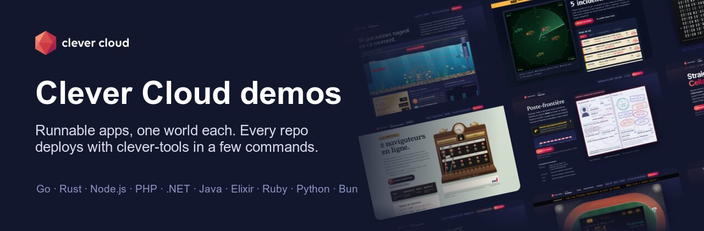</a>

Runnable apps that show what [Clever Cloud](https://www.clever.cloud) does, one world per demo: an aquarium for the Go runtime, a control tower for Rust and PostgreSQL, a border post for Keycloak.

Every repo follows the same form:

- desktop and phone screenshots of the app running;
- **Run it yourself**: deploy it on your own Clever Cloud organization with [clever-tools](https://github.com/CleverCloud/clever-tools) in a few commands;
- the variables, the routes and a short code tour;
- the page itself shows what the platform is doing: instance, add-on, network.

<table>
<tr>
<td width="130" align="center"><a href="https://academy.clever.cloud/">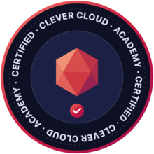</a></td>
<td><b>Get certified.</b> Every demo here carries the same invitation: learn to deploy your own apps on Clever Cloud the same way, and get certified.  <a href="https://academy.clever.cloud/"><b>Get certified at the Clever Cloud Academy ↗</b></a></td>
</tr>
</table>

### Runtimes

<table>
<tr>
<td width="33%" valign="top"><a href="https://github.com/Vitiosum/demo-go">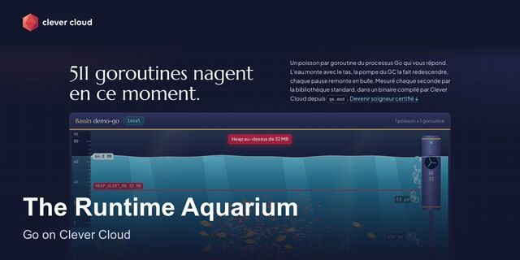</a> <a href="https://github.com/Vitiosum/demo-go"><b>demo-go</b></a> Every goroutine is a fish, the water rises with the heap.</td>
<td width="33%" valign="top"><a href="https://github.com/Vitiosum/demo-rust-postgresql">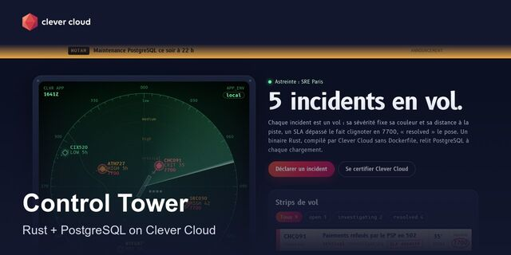</a> <a href="https://github.com/Vitiosum/demo-rust-postgresql"><b>demo-rust-postgresql</b></a> Incidents on a radar, a breached SLA squawks 7700.</td>
<td width="33%" valign="top"><a href="https://github.com/Vitiosum/demo-nodejs-postgresql">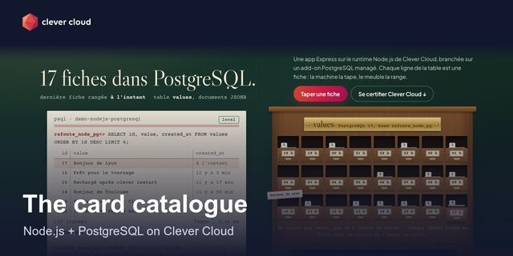</a> <a href="https://github.com/Vitiosum/demo-nodejs-postgresql"><b>demo-nodejs-postgresql</b></a> Every row is a card, psql is the librarian's typewriter.</td>
</tr>
<tr>
<td width="33%" valign="top"><a href="https://github.com/Vitiosum/demo-php-frankenphp">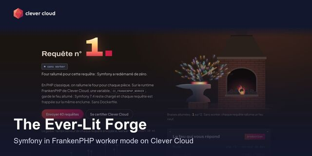</a> <a href="https://github.com/Vitiosum/demo-php-frankenphp"><b>demo-php-frankenphp</b></a> Symfony in worker mode: the kernel never cools down.</td>
<td width="33%" valign="top"><a href="https://github.com/Vitiosum/runrank">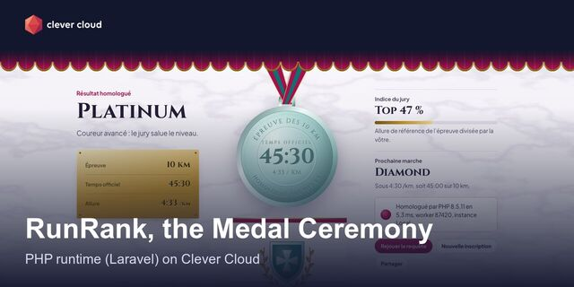</a> <a href="https://github.com/Vitiosum/runrank"><b>runrank</b></a> A pace calculator that engraves a medal for every rank.</td>
<td width="33%" valign="top"><a href="https://github.com/Vitiosum/demo-react-vite">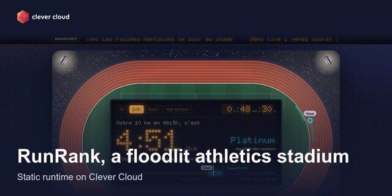</a> <a href="https://github.com/Vitiosum/demo-react-vite"><b>demo-react-vite</b></a> A night stadium served as plain files by Caddy.</td>
</tr>
<tr>
<td width="33%" valign="top"><a href="https://github.com/Vitiosum/demo-dotnet-blazor">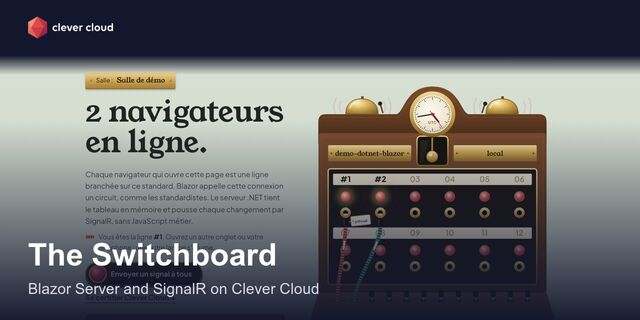</a> <a href="https://github.com/Vitiosum/demo-dotnet-blazor"><b>demo-dotnet-blazor</b></a> Blazor Server and SignalR: every browser is a plugged-in line.</td>
<td width="33%" valign="top"><a href="https://github.com/Vitiosum/clevercloud-dotnet-minimal">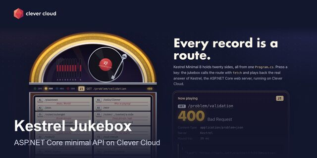</a> <a href="https://github.com/Vitiosum/clevercloud-dotnet-minimal"><b>clevercloud-dotnet-minimal</b></a> Every record is a route: press a key, hear the HTTP answer.</td>
<td width="33%" valign="top"><a href="https://github.com/Vitiosum/demo-java-mongodb">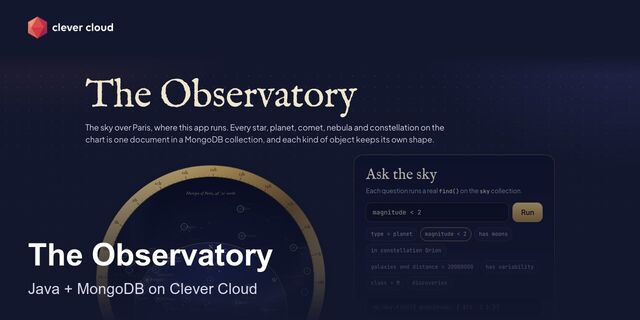</a> <a href="https://github.com/Vitiosum/demo-java-mongodb"><b>demo-java-mongodb</b></a> Spring Boot maps the sky over Paris, one document per object.</td>
</tr>
<tr>
<td width="33%" valign="top"><a href="https://github.com/Vitiosum/demo-elixir-phoenix">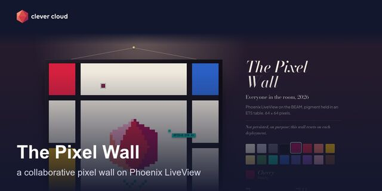</a> <a href="https://github.com/Vitiosum/demo-elixir-phoenix"><b>demo-elixir-phoenix</b></a> A shared 64×64 wall, one BEAM process per visitor.</td>
<td width="33%" valign="top"><a href="https://github.com/Vitiosum/demo-ruby-redis">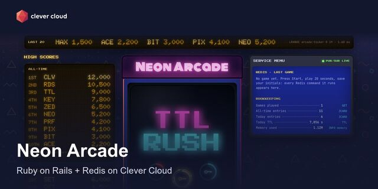</a> <a href="https://github.com/Vitiosum/demo-ruby-redis"><b>demo-ruby-redis</b></a> A 20-second game where Redis runs the leaderboards.</td>
<td width="33%" valign="top"><a href="https://github.com/Vitiosum/demo-docker">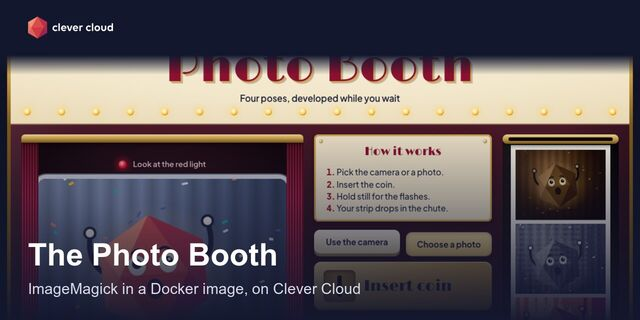</a> <a href="https://github.com/Vitiosum/demo-docker"><b>demo-docker</b></a> A Go photo booth printing strips with ImageMagick.</td>
</tr>
</table>

### Data, storage and messaging

<table>
<tr>
<td width="33%" valign="top"><a href="https://github.com/Vitiosum/demo-cellar-darkroom">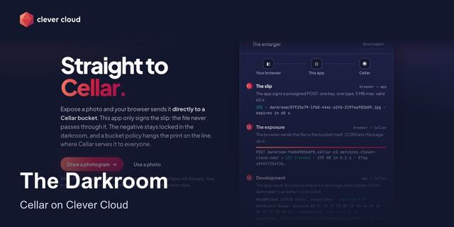</a> <a href="https://github.com/Vitiosum/demo-cellar-darkroom"><b>demo-cellar-darkroom</b></a> Uploads straight to Cellar: public prints, private negatives.</td>
<td width="33%" valign="top"><a href="https://github.com/Vitiosum/demo-python-mysql-cellar">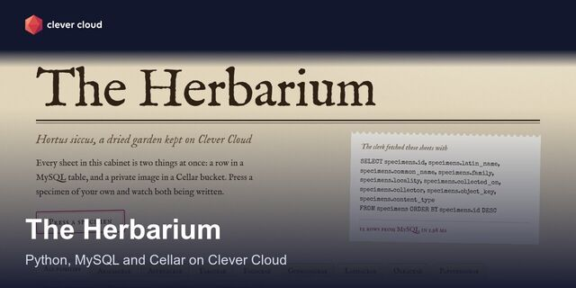</a> <a href="https://github.com/Vitiosum/demo-python-mysql-cellar"><b>demo-python-mysql-cellar</b></a> FastAPI presses each specimen into MySQL and a private Cellar image.</td>
<td width="33%" valign="top"><a href="https://github.com/Vitiosum/demo-fs-bucket">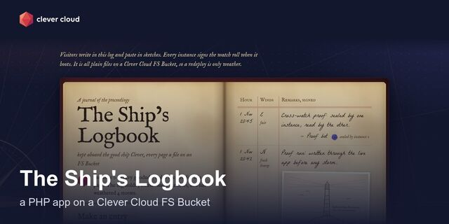</a> <a href="https://github.com/Vitiosum/demo-fs-bucket"><b>demo-fs-bucket</b></a> A logbook kept as plain files that survive every redeploy.</td>
</tr>
<tr>
<td width="33%" valign="top"><a href="https://github.com/Vitiosum/demo-bun-materia-kv">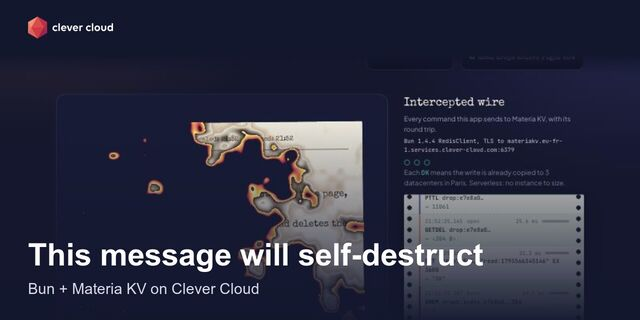</a> <a href="https://github.com/Vitiosum/demo-bun-materia-kv"><b>demo-bun-materia-kv</b></a> One-time messages that burn after reading (TTL, GETDEL).</td>
<td width="33%" valign="top"><a href="https://github.com/Vitiosum/demo-pulsar">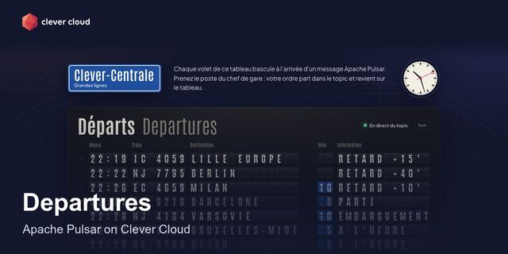</a> <a href="https://github.com/Vitiosum/demo-pulsar"><b>demo-pulsar</b></a> A split-flap departures board fed live by a Pulsar topic.</td>
</tr>
</table>

### Managed tools

<table>
<tr>
<td width="33%" valign="top"><a href="https://github.com/Vitiosum/demo-matomo">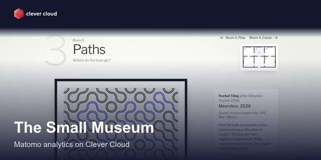</a> <a href="https://github.com/Vitiosum/demo-matomo"><b>demo-matomo</b></a> A generative-art museum with cookieless analytics.</td>
<td width="33%" valign="top"><a href="https://github.com/Vitiosum/demo-metabase">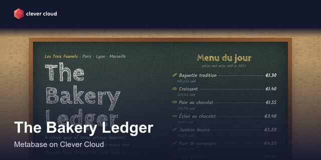</a> <a href="https://github.com/Vitiosum/demo-metabase"><b>demo-metabase</b></a> A year in three bakeries: signed embeds and SQL receipts.</td>
<td width="33%" valign="top"><a href="https://github.com/Vitiosum/demo-azimutt">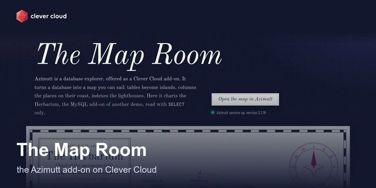</a> <a href="https://github.com/Vitiosum/demo-azimutt"><b>demo-azimutt</b></a> A MySQL schema charted like a coastline.</td>
</tr>
<tr>
<td width="33%" valign="top"> <a href="https://github.com/Vitiosum/demo-elastic"><b>demo-elastic</b></a> Every request is a ship, Elastic APM follows its voyage.</td>
<td width="33%" valign="top"><a href="https://github.com/Vitiosum/demo-otoroshi-gateway">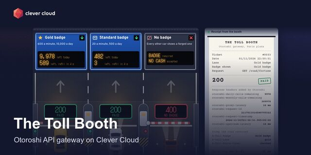</a> <a href="https://github.com/Vitiosum/demo-otoroshi-gateway"><b>demo-otoroshi-gateway</b></a> An API gateway as a toll plaza: badges, quotas, rate limits.</td>
<td width="33%" valign="top"><a href="https://github.com/Vitiosum/demo-jenkins">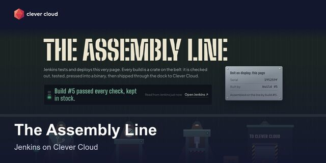</a> <a href="https://github.com/Vitiosum/demo-jenkins"><b>demo-jenkins</b></a> Jenkins tests and deploys a Go app, every build is a crate.</td>
</tr>
</table>

### Security and compliance

<table>
<tr>
<td width="33%" valign="top"><a href="https://github.com/Vitiosum/demo-keycloak">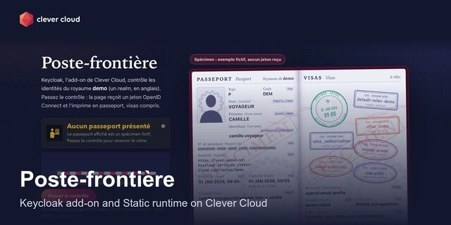</a> <a href="https://github.com/Vitiosum/demo-keycloak"><b>demo-keycloak</b></a> Log in with OIDC, the token is printed as a passport.</td>
<td width="33%" valign="top"><a href="https://github.com/Vitiosum/demo-kms-notary">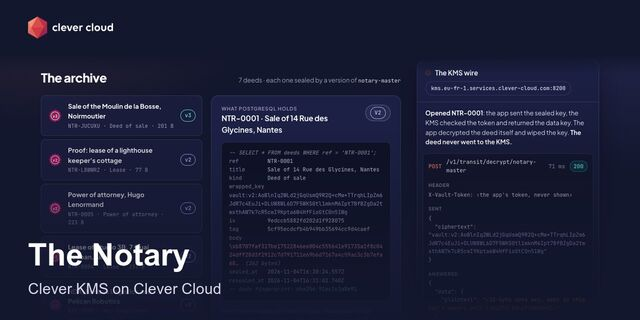</a> <a href="https://github.com/Vitiosum/demo-kms-notary"><b>demo-kms-notary</b></a> Every deed sealed with its own key, the master key never leaves Clever KMS.</td>
<td width="33%" valign="top"><a href="https://github.com/Vitiosum/demo-network-groups">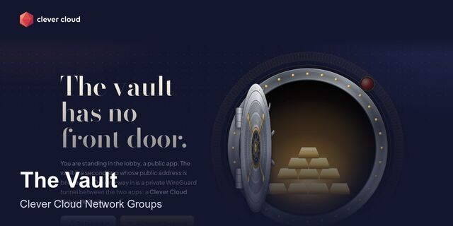</a> <a href="https://github.com/Vitiosum/demo-network-groups"><b>demo-network-groups</b></a> The public door is bricked up, the only way in is a private tunnel.</td>
</tr>
<tr>
<td width="33%" valign="top"><a href="https://github.com/Vitiosum/demo-rust-hds">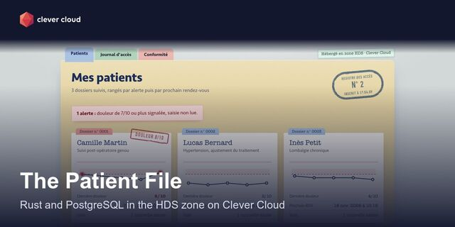</a> <a href="https://github.com/Vitiosum/demo-rust-hds"><b>demo-rust-hds</b></a> A patient file in the HDS zone, with 21 live hosting checks.</td>
</tr>
</table>

### Platform, operations and migration

<table>
<tr>
<td width="33%" valign="top"><a href="https://github.com/Vitiosum/demo-zero-downtime">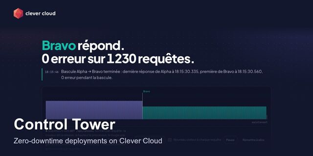</a> <a href="https://github.com/Vitiosum/demo-zero-downtime"><b>demo-zero-downtime</b></a> A control tower counts every error while you deploy, roll back and scale.</td>
<td width="33%" valign="top"><a href="https://github.com/Vitiosum/demo-iac-terraform">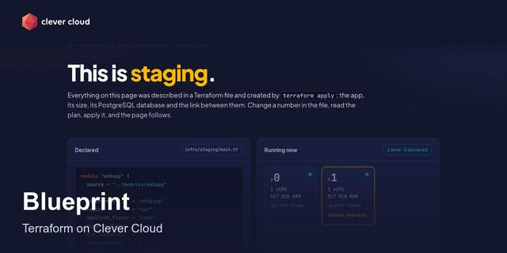</a> <a href="https://github.com/Vitiosum/demo-iac-terraform"><b>demo-iac-terraform</b></a> Staging and production in Terraform, the state kept in Cellar.</td>
<td width="33%" valign="top"><a href="https://github.com/Vitiosum/demo-workers-cron">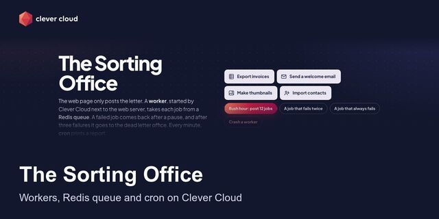</a> <a href="https://github.com/Vitiosum/demo-workers-cron"><b>demo-workers-cron</b></a> A sorting office: the page posts the job, a worker delivers it, cron prints the report.</td>
</tr>
<tr>
<td width="33%" valign="top"><a href="https://github.com/Vitiosum/demo-cke-harbour">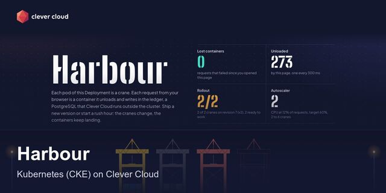</a> <a href="https://github.com/Vitiosum/demo-cke-harbour"><b>demo-cke-harbour</b></a> A Go service on managed Kubernetes: every pod is a crane, autoscaled at rush hour.</td>
<td width="33%" valign="top"><a href="https://github.com/Vitiosum/demo-config-provider">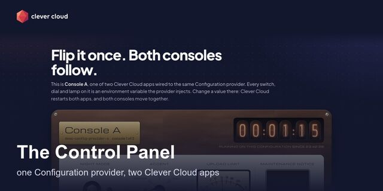</a> <a href="https://github.com/Vitiosum/demo-config-provider"><b>demo-config-provider</b></a> Two apps share one configuration: flip a switch, both follow.</td>
<td width="33%" valign="top"><a href="https://github.com/Vitiosum/Demo_Heroku_Nodejs-PG">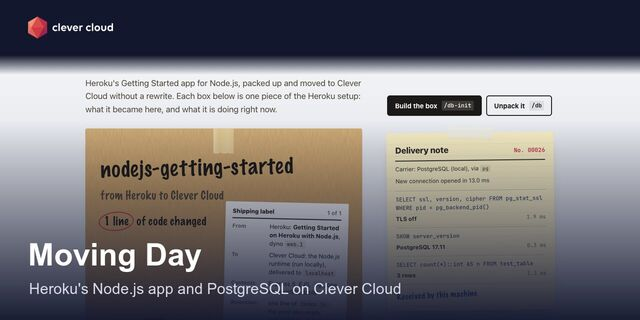</a> <a href="https://github.com/Vitiosum/Demo_Heroku_Nodejs-PG"><b>Demo_Heroku_Nodejs-PG</b></a> Heroku's getting-started app, moved with one changed line.</td>
</tr>
<tr>
<td width="33%" valign="top"><a href="https://github.com/Vitiosum/supabase-to-clever-cloud">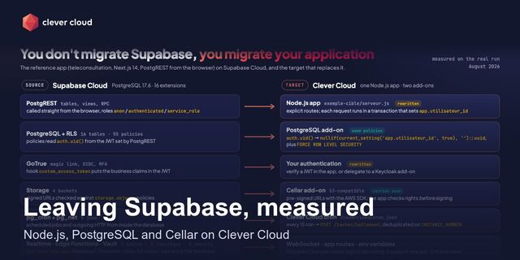</a> <a href="https://github.com/Vitiosum/supabase-to-clever-cloud"><b>supabase-to-clever-cloud</b></a> Leaving Supabase, measured: inventory, mapping, costs.</td>
</tr>
</table>

### Agent skills

- [**land-on-clever-cloud**](https://github.com/Vitiosum/land-on-clever-cloud): migrate an app from Heroku, Vercel, Supabase, docker-compose or a VM to Clever Cloud, with Claude Code or Codex.
- [**clever-tools-skill**](https://github.com/Vitiosum/clever-tools-skill): deploy, configure and diagnose an app on Clever Cloud with clever-tools.

### Also running on Clever Cloud

- [**clash-royale-advisor**](https://github.com/Vitiosum/clash-royale-advisor): a Clash Royale deck advisor on Next.js, PostgreSQL and Redis.
